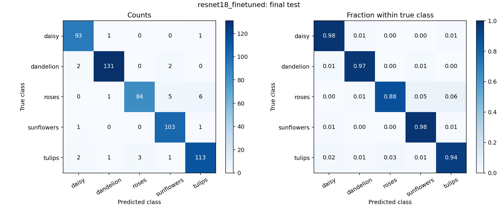

# Flower Image Classification

Custom CNNs, ResNet18 transfer learning, Grad-CAM explanations, and an image-upload demo for five flower classes.

The validation-selected **fine-tuned ResNet18 achieved 95.10% accuracy and 0.9494 macro-F1 on 551 held-out test images**. The custom CNN baseline achieved 73.32% accuracy. This repository contains the training/evaluation code, reproducible Colab notebooks, completed experiment records, and saved results from the five-day project.

**Start here:** [run the demo](#run-the-demo) · [reproduce the experiments](docs/REPRODUCIBILITY.md) · [model card](docs/MODEL_CARD.md) · [completed notebooks](notebooks/completed) · [final report](reports/final_report.pdf)

## Results

| Experiment | Validation accuracy | Validation macro-F1 | Test accuracy | Test macro-F1 | Allocated epochs |
|---|---:|---:|---:|---:|---:|
| Custom CNN baseline | 68.06% | 0.6740 | 73.32% | 0.7293 | 12 |
| Custom CNN with augmentation | 67.51% | 0.6667 | 72.78% | 0.7207 | 12 |
| ResNet18, frozen backbone | 84.75% | 0.8460 | 89.47% | 0.8928 | 6 |
| **ResNet18, full fine-tuning (selected)** | **94.01%** | **0.9393** | **95.10%** | **0.9494** | **12** |
| ResNet18, continued-training control | 93.83% | 0.9379 | 95.46% | 0.9530 | 18 |
| ResNet18, wider crop variation | 93.65% | 0.9357 | 96.01% | 0.9577 | 18 |

Selection used validation macro-F1, then lower validation loss. The original fine-tuned model won validation and was frozen before test inference. The crop experiment later had the highest test accuracy, but test rankings did not change the selected model or demo checkpoint. The crop intervention reduced validation macro-F1 by 0.0022 against matched continued training; this experiment does not establish an improvement.

The two Day 5 arms start from identical weights and differ only in training crop area: `(0.75, 1.0)` versus `(0.5, 1.0)`. Capacity, ImageNet pretraining, and allocated training budgets differ across model families. All results use one split and seed.



Machine-readable exports: [validation table](results/day5/validation_comparison.csv), [test table](results/day5/final_test_comparison.csv), [per-class test metrics](results/day5/test/resnet18_finetuned/classification_report.json), and [frozen selection](results/provenance/selection.json).

## Dataset and methodology

- **Flower Photos:** daisy, dandelion, roses, sunflowers, and tulips.
- **Audit:** 3,670 original images; four exclusions after exact-duplicate/conflicting-label checks; 3,666 accepted images.
- **Fixed stratified splits:** 2,564 training, 551 validation, 551 test; seed 42. The original [manifest](data/processed/splits.csv) is committed.
- **Training:** three-block CNN; augmentation comparison; ImageNet-pretrained ResNet18 with frozen-head training and full fine-tuning; a matched crop experiment.
- **Evaluation:** accuracy, precision, recall, macro/weighted F1, count/normalized confusion matrices, and Grad-CAM.
- **Explainability review:** 20 correct and 20 incorrect validation predictions. The saved log distinguishes **13 user reviews and 27 authorized AI-assisted visual reviews**.

Validation guided error analysis and model selection. The held-out test comparison ran after the selection and checkpoint hashes were frozen. Recorded test results are final; further tuning after viewing them needs a fresh evaluation protocol.

## Run the demo

Use **Python 3.12**. The original GPU experiments ran in Colab with Python 3.13; local CPU verification used Python 3.12. The requirements record the completed experiment's core PyTorch/torchvision versions. Install the matching CPU or CUDA build for your machine using [PyTorch's installation instructions](https://pytorch.org/get-started/locally/).

From this folder on Windows:

```powershell
python -m venv .venv
.\.venv\Scripts\python.exe -m pip install -r requirements.txt
.\.venv\Scripts\python.exe app.py --backup "path\to\day5_backup.zip"
```

On macOS/Linux, use `.venv/bin/python` in place of `.\.venv\Scripts\python.exe`.

**Trained weights are a separate artifact:** keep the completed `day5_backup.zip` alongside your submission and supply its actual path above. Raw photographs, checkpoints, and backup ZIPs are excluded from Git. The restoration helper verifies the recorded ZIP SHA-256, restores data/output artifacts, and preserves existing matching files. It does not import archived Python files. Once restored, start the demo with `python app.py` using your virtual environment.

The Gradio app opens at `http://127.0.0.1:7860`. Upload a photo to see all five class scores and the predicted-class Grad-CAM overlay. It uses the frozen selected checkpoint and the same evaluation preprocessing. Public sharing is disabled.

For an inference check without starting a web server:

```powershell
.\.venv\Scripts\python.exe app.py --backup "path\to\day5_backup.zip" --check
```

This uses the credited training sample in `assets/` to check functionality. It is not additional test-set evidence. Scores are uncalibrated, and unfamiliar images still receive one of the five labels.

## Reproduce the project

Open the clean notebooks in `notebooks/` in Google Colab, choose a T4 GPU for training, and run Days 1-5 in order. Each notebook embeds its helper sources and prompts for the previous day's backup when needed. Historical executed copies are in `notebooks/completed/`.

For local data preparation and the original training stages:

```powershell
python flower_data.py --root . --seed 42
python flower_training.py --root . --epochs 12 --batch-size 32
python flower_transfer.py --root . --head-epochs 6 --fine-epochs 6 --batch-size 32
```

These commands use the activated virtual environment; CPU training requires `--allow-cpu`. Day 4 review and the controlled/frozen Day 5 workflow are documented in the notebooks and [reproducibility guide](docs/REPRODUCIBILITY.md). Reproduce new runs in a fresh working directory so the accepted frozen artifacts remain intact. GPU training can vary slightly across hardware/library versions.

## Repository layout

```text
flower-image-classification/
  app.py                       Local Gradio demo and inference check
  flower_*.py                  Data, training, transfer, evaluation, review, demo
  requirements*.txt            Runtime, development, and data-only dependencies
  notebooks/                   Five clean, runnable Colab notebooks
    completed/                 Five executed notebook snapshots
  data/processed/              Original split manifest and label mapping
  results/                     Recorded Days 1-5 metrics, curves, logs, and reviews
    provenance/                Frozen selection, artifact hashes, and test lock
  reports/                     Generated report and presentation notes
  assets/                      Credited sample image for a functional demo
  docs/                        Model card, reproduction, structure, and upload guide
  tests/                       Fixture tests; no dataset download or real test inference
  tools/                       Notebook builders, artifact restore, evidence checks
  .github/workflows/tests.yml  CPU tests for pushes and pull requests
```

See the [file guide](docs/PROJECT_STRUCTURE.md) for each module and the [results index](results/README.md) for saved evidence. Runtime `outputs/`, downloaded data, and weights are created locally and ignored by Git.

## Verification

```powershell
python -m pip install -r requirements-dev.txt
python tools/check_repository.py
python -m unittest discover -s tests -v
```

Checks cover data integrity and split leakage, metric math, frozen-backbone behavior, Grad-CAM, validation-only selection, immutable checkpoint plans, and archive restoration. The evidence checker independently reconciles stored test predictions/reports with the manifest and verifies the 40-case review. CI runs CPU checks; it does not download the dataset or train models. Local verification details are recorded in [VALIDATION.md](docs/VALIDATION.md).

## Limitations and next steps

One split and seed limit generalization claims. Exact duplicate checks do not eliminate all near duplicates or label issues. The review sample favors confident errors and includes AI assistance. Grad-CAM is approximate and does not prove that highlighted regions caused an error. Softmax scores are not calibrated probabilities.

Future work could measure variability across seeds, audit near duplicates, investigate rose/tulip confusion, and evaluate calibration and unfamiliar inputs using a new held-out evaluation protocol. See the [model card](docs/MODEL_CARD.md).

## Attribution

Flower Photos and its individual image credits are documented in [DATASET_IMAGE_CREDITS.txt](docs/DATASET_IMAGE_CREDITS.txt). The sample image and Grad-CAM panels retain their source-image attribution; code licensing does not replace image licenses. Sources: [Flower Photos tutorial](https://www.tensorflow.org/tutorials/load_data/images), [PyTorch transfer learning](https://docs.pytorch.org/tutorials/beginner/transfer_learning_tutorial.html), and [Grad-CAM paper](https://openaccess.thecvf.com/content_ICCV_2017/papers/Selvaraju_Grad-CAM_Visual_Explanations_ICCV_2017_paper.pdf).

The project was developed with AI assistance. Saved review provenance and recorded experiment results are preserved. Code is available under the [MIT license](LICENSE); dataset images and third-party dependencies retain their respective licenses. Upload instructions are in [GITHUB_UPLOAD.md](docs/GITHUB_UPLOAD.md).
